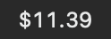
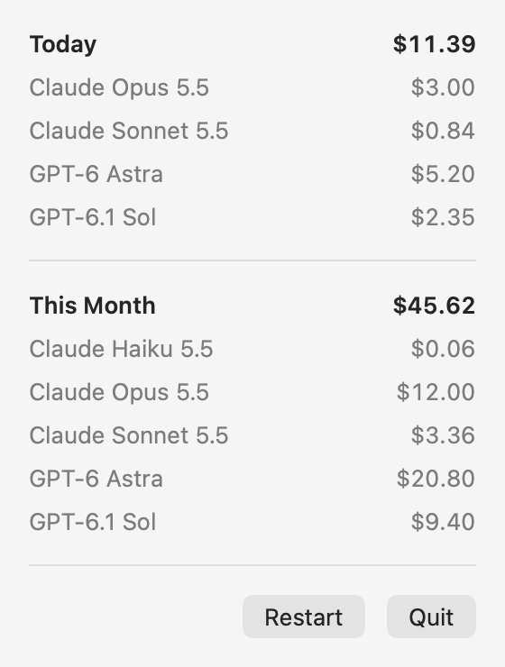

# Codex Cost

See the API-equivalent cost of your coding agents in the macOS menu bar. Codex Cost reads local **Codex, Claude Code, Pi, and OpenCode** usage and estimates what the recorded tokens would cost at published Standard API rates—even when you use a subscription.





*Native app views captured with synthetic usage data.*

## Features

- Today's total at a glance; click for Today and This Month totals and a breakdown by model.
- Automatic refresh every 30 seconds, using your Mac's timezone for days and calendar months.
- Local, read-only processing. No API key, account connection, third-party dependencies, or network activity.
- Restart and Quit controls in the panel.
- A read-only JSON report for diagnostics and reproducible accounting.

These are **token-cost estimates**, not your subscription bill or an exact historical API invoice. Subscription usage counts when it is recorded locally; your subscription payment is unaffected.

## Requirements

- macOS 13 or later.
- Locally recorded usage from at least one supported agent.
- To build from source: Swift 6 and Apple's Command Line Tools or Xcode.

## Install and run

**No versioned release has been published yet.** Build from source using the steps below. The [release workflow](.github/workflows/release.yml) will publish a universal Apple Silicon + Intel ZIP when a maintainer tags a validated version; see [GitHub Releases](https://github.com/bsamek/aicost/releases) for future downloads.

When a release is available, download `Codex-Cost-VERSION-universal.zip`, unzip it, and drag `Codex Cost.app` to `/Applications`. Downloads are ad-hoc signed; they are **not Developer ID signed or notarized**. If macOS blocks a download you trust, try opening it once, then use **System Settings → Privacy & Security → Open Anyway** and confirm Open ([Apple's instructions](https://support.apple.com/102445)). The adjacent `.zip.sha256` file checks integrity with `shasum -a 256 -c Codex-Cost-VERSION-universal.zip.sha256`; it does not establish publisher identity.

Build from a checkout:

```sh
git clone https://github.com/bsamek/aicost.git
cd aicost
bash scripts/build-app.sh
open 'build/Codex Cost.app'
```

The build uses your Mac's architecture and ad-hoc signs the bundle locally. Keep the app in the build folder or copy it to `/Applications`. Open it again after restarting your Mac. To update, use **Quit** in the panel, replace the app, and open the new copy; local usage logs live outside the app.

## Usage and log locations

Open the app, then click its dollar total in the menu bar. Both periods group models by provider and family, with newer numeric versions first. Unknown providers and families appear last by model ID. Only models with priced usage appear in the panel; use the diagnostic report to inspect skipped or unpriced records.

| Agent | Default local source | Override |
| --- | --- | --- |
| Codex | `~/.codex/sessions` and `~/.codex/archived_sessions` | `CODEX_HOME` |
| Claude Code | `~/.claude/projects/**/*.jsonl`, including nested subagents | `CLAUDE_CONFIG_DIR` |
| Pi | `~/.pi/agent/sessions/**/*.jsonl` (v2/v3 sessions) | `PI_CODING_AGENT_DIR` |
| OpenCode | `~/.local/share/opencode/opencode.db` | `XDG_DATA_HOME` (the app appends `/opencode`) |

Finder launches usually do not inherit shell environment variables. For custom roots, launch the executable from a shell:

```sh
CODEX_HOME=/absolute/path/to/codex \
CLAUDE_CONFIG_DIR=/absolute/path/to/claude \
'build/Codex Cost.app/Contents/MacOS/CodexCost'
```

The app reads usage and session metadata without changing logs. OpenCode is scanned through a private temporary copy of its database and committed WAL, removed after each scan. It does not access authentication files, send data to a server, or print conversation text in reports.

## Pricing and coverage

Bundled catalogs record rate sources and verification dates: [`pricing.json`](Sources/CostCore/Resources/pricing.json), [`pi-pricing.json`](Sources/CostCore/Resources/pi-pricing.json), and [`opencode-pricing.json`](Sources/CostCore/Resources/opencode-pricing.json). Sources include [OpenAI](https://developers.openai.com/api/docs/pricing), [Claude](https://platform.claude.com/docs/en/about-claude/pricing), [Fireworks](https://docs.fireworks.ai/serverless/pricing), and [OpenCode Console](https://dev.opencode.ai/v2/docs/console/models).

The bundled Standard rates apply to all displayed history. Input, cache usage, and output are priced separately; long-context tiers use recorded request input. Repeated counters, identifiable inherited history, and duplicate messages are handled within each agent's accounting format. Provider/model rows stay separate where provider-specific pricing matters.

Unknown models and ambiguous usage are excluded from dollar totals. Missing/deleted logs, cloud-only or unrecorded requests, non-token tool charges, fast/priority modes, regional premiums, custom prices, and negotiated discounts are outside coverage. Local formats are not stable billing APIs, so estimates can differ from invoices and historical rates. See [accounting and pricing coverage](docs/accounting.md) for supported provider/model IDs, cache-write rules, deduplication, schema support, and other limits.

## Diagnostic report

```sh
'build/Codex Cost.app/Contents/MacOS/CodexCost' --report
```

This prints JSON with the same accounting totals as the app without opening the UI. Add an ISO 8601 timestamp for a reproducible cutoff:

```sh
'build/Codex Cost.app/Contents/MacOS/CodexCost' --report --at 2026-10-12T16:00:00Z
```

The report includes file/diagnostic counts, per-model totals, and reasons for unpriced usage. It reads only session metadata and usage.

## Development and tests

With a standard Swift 6 installation:

```sh
swift test --disable-xctest --enable-swift-testing
swift build -c release
```

For a Command Line Tools installation with inconsistent package interfaces, the repository includes a local workaround:

```sh
scripts/swift-tool.sh test --disable-sandbox --disable-xctest
```

[`swift-tool.sh`](scripts/swift-tool.sh) uses SwiftPM and local copies of public package interfaces; it leaves system files untouched. The bundle builder uses this wrapper too.

GitHub Actions runs `CostCoreTests` and `AppTests` on pull requests and pushes to `main` with macOS 15 and Xcode 16.4's Swift 6 toolchain. Tests use synthetic fixtures and temporary directories, so they require no personal logs, API credentials, or account access. Compilation errors and test failures fail CI.

After the tests pass, CI packages and validates a universal app ZIP, including metadata, resources, signature integrity, relocated reports, and startup after extraction. PR artifacts use version `0.0.0`; they are previews, not public releases. See [release maintenance](docs/releases.md) for local packaging, publication gates, and signing limits.
